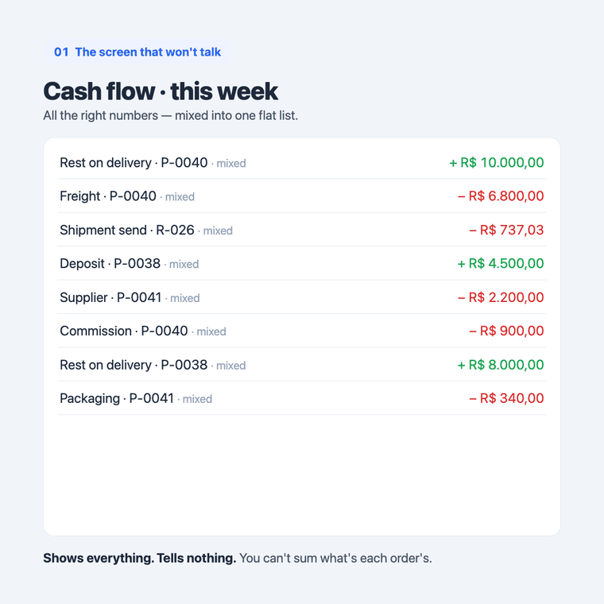

<div align="center">


# uiux-forge

**Rethinks a screen until it tells its story at a glance — _then_ makes it beautiful.**

[](https://github.com/crisweiser/uiux-forge/stargazers)
[](https://github.com/crisweiser/uiux-forge/network/members)
[](./LICENSE)
[](https://docs.claude.com/en/docs/claude-code)

**English** | [Português](./README-PT.md)

</div>

---

## ⚡ Overview

Most "improve this UI" tools jump straight to paint: nicer colors, rounder corners, a gradient.
But a pretty screen that still confuses isn't done — and polishing a badly-structured screen is
painting a crooked wall.

uiux-forge does it in the right order:

> **The logic chooses, you confirm, then unslop beautifies.**
>
> 1. It simulates 4-6 *real* layouts with your *real* data and picks the clearest by criteria.
> 2. It shows you the ranked mockups — the winner on top, **each loser with the reason it lost**.
> 3. Only after you say go does it run an aesthetic pass that removes the generic AI look.

Structure first. Skin second. Clear earns pretty.

## 🧠 Why logic-first beats pretty-first

The mistake it kills: grabbing the first layout that comes to mind, polishing it, shipping. The
first idea is almost never the clearest — you only know by comparing side by side with the same
data. So uiux-forge *compares before it chooses*, decides by a "least doubt" ruler (does it answer
the question at a glance? is the scope clear? do the numbers line up? does it survive the worst-case
volume? does it hold at 360px?), and shows you the reasoning instead of handing you a result you
can't question.

Then — and only then — it borrows unslop's idea: a visual direction pulled from your product, and
ordered refinement passes that strip the purple gradients, glows, emoji-icons and mismatched
spacing that scream "an AI made this."

## 🔄 Workflow

| # | Phase | What happens |
|---|-------|-------------|
| 1 | **Complaint → questions** | Turn "it doesn't help me understand" into the 2-4 questions the person actually asks the screen. A concrete example becomes the acceptance test. |
| 2 | **Study** | Read the whole screen, the domain, the business rules, the sibling screens; pull real data. |
| 3 | **Simulate 4-6 variants** | Structurally different layouts, same real data, shot at 1280px and 360px. |
| 4 | **Judge by criteria** | Pick the winner by the "least doubt" ruler — from the screenshots, not the code. |
| 5 | ★ **Showcase gate** | Serve a page: winner on top, each loser with *why it lost*. You confirm before anything is written. |
| 6 | ★ **Unslop the winner** | Visual direction + ordered passes (spacing → color → icons → copy → type → layout → detail → visuals → motion) + anti-slop checklist. |
| 7 | **Implement test-first** | A test that reproduces the example and the grouping rule. Red → green. |
| 8 | **Verify for real** | 1280px & 360px, light & dark, no horizontal scroll. |
| 9 | **Deliver + before/after** | Side-by-side before/after; optional square video to post. |

> **Shortcut:** if the screen is already clear and only looks generic, it skips the variant
> simulation and does 2-3 targeted refinements instead of a full redesign.

## 🎬 Demo

<div align="center">

<!-- TODO: replace with the real before→variants→showcase→unslopped capture -->


</div>

## 📸 How it looks

<table>
  <tr>
    <td align="center"><br/><sub>1 · the confusing screen</sub></td>
    <td align="center"><br/><sub>2 · variants, same data</sub></td>
    <td align="center"><br/><sub>3 · showcase: why each lost</sub></td>
  </tr>
  <tr>
    <td align="center"><br/><sub>4 · the winner, by logic</sub></td>
    <td align="center"><br/><sub>5 · unslopped</sub></td>
    <td align="center"><br/><sub>6 · 360px, no sideways scroll</sub></td>
  </tr>
</table>

## 🚀 Quick start

Install as a [Claude Code](https://docs.claude.com/en/docs/claude-code) plugin:

```bash
/plugin marketplace add crisweiser/uiux-forge
/plugin install uiux-forge@crisweiser
```

Then just talk to it:

```
this screen is messy, help me rethink it
melhora a UX dessa tela
simulate a few layouts for this dashboard and show me why you'd pick one
```

**Manual install** (any agent that reads skills): copy `skills/uiux-forge/` into your skills folder.

## 🧩 How it works under the hood

- `skills/uiux-forge/SKILL.md` — the 9-phase method.
- `references/variants.md` — the catalog of layout archetypes and when each wins.
- `references/criteria.md` — the "least doubt" ruler.
- `references/showcase.md` — how the logic-vs-you gate works.
- `references/unslop-passes.md` — the ordered aesthetic passes + anti-slop checklist.
- `references/verification.md` — how it checks the real screen.
- `assets/mockup-template.html` + `assets/showcase-template.html` — the comparison pages.

## 📄 License & credits

[CC BY 4.0](./LICENSE) — use it, fork it, keep the credit.

The aesthetic-pass idea is adapted from [**unslop**](https://github.com/heydamir/unslop) by Damir
Sokolovsky. uiux-forge adds the structure-first method: real-data variant simulation, the
"show me why each lost" gate, acceptance tests, and mobile/dark verification.

<div align="center"><sub>Built by <a href="https://github.com/crisweiser">Cris Weiser</a>.</sub></div>
